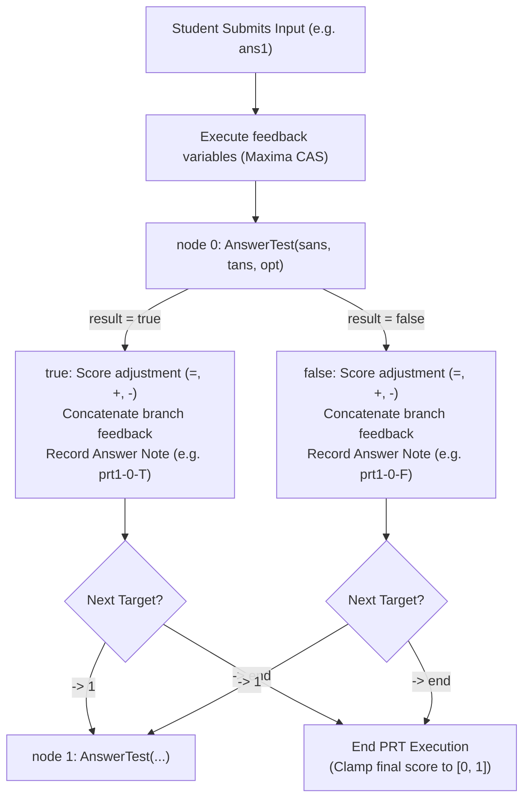

# STACK Question Sketch Authoring Guide & Answer Test Glossary

> **An instructor-friendly, practical guide for university mathematics and science educators authoring Moodle STACK questions in `.stack.md` format without web forms.**

---

## Table of Contents

1. [Quick Start & Core Mental Model](#1-quick-start--core-mental-model)
   - [The Four Pillars of `.stack.md`](#the-four-pillars-of-stackmd)
   - [CLI Quick Reference & Terminal Lookup](#cli-quick-reference--terminal-lookup)
   - [Annotated Complete Question Sketch](#annotated-complete-question-sketch)
2. [Front Matter (`+++ ... +++`) & Question Settings](#2-front-matter-------question-settings)
   - [TOML Syntax & Common Metadata](#toml-syntax--common-metadata)
   - [Display Options Lookup Table](#display-options-lookup-table)
3. [CAS Variables & Rich-Text CASText2 Sections](#3-cas-variables--rich-text-castext2-sections)
   - [Question Variables (`## Question variables`)](#question-variables--question-variables)
   - [Rich-Text HTML Sections](#rich-text-html-sections)
   - [CASText2 Interpolation: `{@expr@}` vs `{#expr#}`](#castext2-interpolation-expr-vs-expr)
   - [Why `## Question note` Is Mandatory with Randomization](#why--question-note-is-mandatory-with-randomization)
4. [Inputs & Hidden Dropdown Codes (`## Inputs`)](#4-inputs--hidden-dropdown-codes--inputs)
   - [Input Grammar & Splitting Rules](#input-grammar--splitting-rules)
   - [Input Widget Cookbook](#input-widget-cookbook)
   - [Input Setting Lookup Tables](#input-setting-lookup-tables)
5. [Potential Response Trees (`## PRT <name>`) — Deep Dive](#5-potential-response-trees--prt-name--deep-dive)
   - [How a PRT Executes (Execution Flowchart)](#how-a-prt-executes-execution-flowchart)
   - [Complete PRT Grammar & Anatomy](#complete-prt-grammar--anatomy)
   - [Node Modifiers, Scoring Modes, & Feedback Formatting](#node-modifiers-scoring-modes--feedback-formatting)
   - [Four Copy-Paste PRT Design Recipes](#four-copy-paste-prt-design-recipes)
6. [Glossary of Answer Tests & Options](#6-glossary-of-answer-tests--options)
   - [Top 5 STACK Answer Test Traps](#top-5-stack-answer-test-traps)
   - [Master Quick-Reference Matrix (All 41 Answer Tests)](#master-quick-reference-matrix-all-41-answer-tests)
   - [Detailed Reference Cards (~22 Core Tests)](#detailed-reference-cards-22-core-tests)
7. [Question Tests (`## Tests`) & Recommended Authoring Workflow](#7-question-tests--tests--recommended-authoring-workflow)
   - [Automated Regression Tests (`## Tests`)](#automated-regression-tests--tests)
   - [Recommended Authoring Workflow](#recommended-authoring-workflow)

---

## 1. Quick Start & Core Mental Model

Moodle STACK is the world's most capable computer-aided assessment engine for STEM disciplines, but authoring questions through Moodle's native web browser forms is slow, repetitive, and error-prone. A typical single STACK question requires navigating dozens of cascading dropdowns, accordion cards, and text boxes spanning over 230 lines of raw XML.

The **`.stack.md` sketch format** replaces that web UI with a clean, Markdown-shaped text file (~30 lines of author decisions) that you can write in your favorite code editor (VS Code, Cursor, Neovim, Zed) alongside instant local browser preview and command-line verification.

### The Four Pillars of `.stack.md`

1. **XML is the single source of truth**: The `.xml` file is always canonical and ready to import into Moodle. The `.stack.md` sketch is an ephemeral, lossless lens that parses from and writes directly back to that XML.
2. **Course defaults are hidden**: Anything in a question matching your course defaults in `macstack.toml` (or STACK built-ins) is omitted from the sketch. **Delete a line or setting from a sketch to reset it to its course default.**
3. **Unmodelled XML is preserved untouched**: Elements outside authoring focus—such as `<deployedseed>` variant tags, `<question type="category">` course hierarchies, and custom XML tags—are preserved byte-for-byte when sketches are compiled back to XML.
4. **Instant terminal lookup**: When you are writing a sketch and forget a test signature, PRT syntax, or widget flag, run `macstack ref` right in your terminal (`macstack ref prt`, `macstack ref tests`, `macstack ref Int`, `macstack ref inputs`) without leaving your editor.

### CLI Quick Reference & Terminal Lookup

```bash
# 1. Start live preview in your browser (SSE hot reload on save)
macstack preview questions/calculus/demo-power-integral.xml

# 2. In a second terminal, launch live watch-mode editing in your editor
macstack edit questions/calculus/demo-power-integral.xml --editor code

# 3. Look up syntax, options, and rules instantly
macstack ref prt          # PRT branch syntax, scoring modes, modifiers
macstack ref inputs       # Input widgets, boxsize, forbidden words, options
macstack ref tests        # All 41 answer tests grouped by category
macstack ref Int          # Detailed signature, options, and examples for Int
macstack ref AddConst     # Syntax and options for AddConst and Antidiff

# 4. Deploy 50 deduplicated variants and run regression tests
macstack deploy-seeds questions/calculus/demo-power-integral.xml -n 50
macstack test questions/calculus/demo-power-integral.xml
```

### Annotated Complete Question Sketch

Below is a complete, production-ready `.stack.md` file for an indefinite integral question. It demonstrates front matter, Maxima variables, verbatim CASText2 HTML, inputs, PRT grading nodes with targeted feedback, hints, and automated regression tests:

````markdown
+++
# Front matter: only non-default settings appear here
name = "Indefinite Integral of a Polynomial"
idnumber = "demo-power-integral"
penalty = 0.1
+++

## Question variables
```maxima
/* 1. Generate randomized coefficients */
a: rand([2, 3, 4, 5, 6]);
b: rand([2, 4, 6, 8]);
n: rand([2, 3, 4]);

/* 2. Target integrand and model answer */
integrand: a*x^n + b*x;
ta1: a*x^(n+1)/(n+1) + (b/2)*x^2 + c;

/* 3. Model common misconceptions for targeted PRT branches */
ans_diff: diff(integrand, x);
ans_no_c: a*x^(n+1)/(n+1) + (b/2)*x^2;
```

## Question text
<p>Evaluate the indefinite integral:</p>
\[ \int \left( {@integrand@} \right) \, dx \]
<p><em>Use \(c\) for the constant of integration.</em></p>
<p>[[input:ans1]] [[validation:ans1]]</p>

## Specific feedback
[[feedback:prt1]]

## General feedback
<p>Apply the power rule for integration term by term:</p>
\[ \int x^k \, dx = \frac{x^{k+1}}{k+1} + c \quad (k \neq -1) \]
<p>For the given integrand:</p>
\[ \int \left( {@integrand@} \right) \, dx = {@a@} \cdot \frac{x^{{@n+1@}}}{{@n+1@}} + {@b@} \cdot \frac{x^2}{2} + c = {@ta1@} \]

## Question note
{@ta1@}

## Inputs
ans1: algebraic, tans=ta1, boxsize=18, forbidfloat=1

## PRT prt1
node 0: Int(ans1, ta1, x)
  true: =1
    <p>Correct! You integrated each term accurately and included the constant of integration \(c\).</p>
  false: -> 1
node 1: AlgEquiv(ans1, ans_diff)
  true: =0
    <p>It appears you differentiated the integrand rather than integrating it. Remember that \(\int x^n \, dx = \frac{x^{n+1}}{n+1} + c\).</p>
  false: -> 2
node 2: AlgEquiv(ans1, ans_no_c)
  true: =0
    <p>You found an antiderivative, but forgot to add the arbitrary constant of integration \(+ c\).</p>

## Tests
### Test 1: Model Answer
ans1 = ta1
prt1 => 1, prt1-0-T

### Test 2: Differentiated Integrand
ans1 = ans_diff
prt1 => 0, prt1-1-T, penalty=0.1

### Test 3: Missing Constant of Integration
ans1 = ans_no_c
prt1 => 0, prt1-2-T, penalty=0.1

## Hint
<p>Integrate each term using \(\int x^n \, dx = \frac{x^{n+1}}{n+1}\) and don't forget to append \(+ c\).</p>
````

---

## 2. Front Matter (`+++ ... +++`) & Question Settings

Every sketch begins with a TOML front-matter block bounded by lines containing only `+++`.

```toml
+++
name = "Partial Fractions Expansion"
idnumber = "math101-calc-w03-q02"
defaultgrade = 2.0
penalty = 0.1
questionsimplify = 1
assumepositive = 0
assumereal = 1
multiplicationsign = "onum"
sqrtsign = 1
+++
```

### TOML Syntax & Common Metadata

| Key | Type | Default | Description |
| :--- | :--- | :--- | :--- |
| `name` | string | *(required)* | Display title of the question in the question bank. |
| `idnumber` | string | `""` | Unique alphanumeric slug used for version tracking and URL routing. |
| `defaultgrade`| float | `1.0` | Maximum points awarded for full credit. |
| `penalty` | float | `0.1` | Mark penalty fraction deducted per incorrect attempt in adaptive/interactive mode. |
| `hidden` | int/bool | `0` | Set `1` to hide the question in Moodle's question bank. |
| `questionsimplify`| int | `1` | Global Maxima simplification flag (`1` = simplify on, `0` = off). |
| `assumepositive`| int | `0` | When `1`, Maxima assumes all variables are real and positive ($x > 0$). |
| `assumereal` | int | `0` | When `1`, Maxima assumes variables are real ($x \in \mathbb{R}$). |
| `isbroken` | int | `0` | Set `1` to flag a question as broken for colleagues/linters. |

### Display Options Lookup Table

In Moodle's web form, display options are buried across several drop-down menus. In `.stack.md`, you set them as simple string keys in front matter. Omit any setting to adopt the course default configured in `macstack.toml`.

| Front Matter Key | Allowed Values | Moodle UI Equivalent & Visual Effect |
| :--- | :--- | :--- |
| `multiplicationsign` | `"dot"` | Centered dot: \(a \cdot b\) |
| | `"cross"` | Multiplication cross: \(a \times b\) |
| | `"onum"` *(default)* | Cross only between numbers: \(2 \times 3\), but \(2x\) and \(xy\) |
| | `"space"` | Thin space: \(a \, b\) |
| | `"none"` | No symbol: \(ab\) |
| `inversetrig` | `"cos-1"` *(default)* | Power style: \(\cos^{-1}(x)\), \(\sin^{-1}(x)\) |
| | `"acos"` | Short prefix: \(\operatorname{acos}(x)\) |
| | `"arccos"` | Full prefix: \(\arccos(x)\), \(\arcsin(x)\) |
| | `"arsinh"` | Hyperbolic area prefix: \(\operatorname{arsinh}(x)\) |
| `complexno` | `"i"` *(default)* | Standard lowercase Roman: \(\mathrm{i}\) |
| | `"j"` | Engineering electrical notation: \(\mathrm{j}\) |
| | `"symi"` / `"symj"` | Math italic: \(i\) / \(j\) |
| `matrixparens` | `"["` *(default)* | Square brackets: \(\begin{bmatrix} a & b \end{bmatrix}\) |
| | `"("` | Round parentheses: \(\begin{pmatrix} a & b \end{pmatrix}\) |
| | `""` | No delimiters: array style |
| | `"{"` | Curly braces: \(\begin{Bmatrix} a & b \end{Bmatrix}\) |
| | `"\|"` | Determinant vertical bars: \(\begin{vmatrix} a & b \end{vmatrix}\) |
| `scientificnotation` | `"*10"` *(default)* | Scientific standard: \(1.23 \times 10^4\) |
| | `"E"` | Calculator notation: \(1.23\mathrm{E}4\) |
| `logicsymbol` | `"lang"` *(default)* | Language words: \(\mathrm{and}\) / \(\mathrm{or}\) / \(\mathrm{not}\) |
| | `"symbol"` | Formal logic symbols: \(\land\) / \(\lor\) / \(\neg\) |
| `decimals` | `"."` *(default)* | Decimal point: `3.1415` |
| | `","` | Decimal comma: `3,1415` |
| `sqrtsign` | `1` *(default)* | Radical root sign: \(\sqrt{x}\) |
| | `0` | Fractional exponent: \(x^{1/2}\) |

---

## 3. CAS Variables & Rich-Text CASText2 Sections

### Question Variables (`## Question variables`)

The `## Question variables` section contains Maxima CAS statements executed before the question is rendered. Statements must end with semicolons `;`.

````markdown
## Question variables
```maxima
/* Random number generation */
k: rand(5) + 2;                         /* integer in {2, 3, 4, 5, 6} */
c: rand([-3, -2, -1, 1, 2, 3]);         /* random choice from list */
step_val: rand_with_step(1, 10, 2);     /* odd integer in [1, 10] */
divisor: rand_with_prohib(2, 9, [k]);   /* integer in [2, 9] excluding k */

/* Polynomial ordering */
ordergreat(x, y);

/* Expression building */
p: expand((x - k)*(x + c));
ta1: p;

/* Dynamic 2D SVG plot */
plot_svg: plot(p, [x, -5, 5], [y, -20, 20]);
```
````

#### Key Maxima Rules & Tips
- **Randomization functions**:
  - `rand(N)` returns an integer in $0 \dots N-1$.
  - `rand([a, b, c])` selects uniformly from a list.
  - `rand_with_step(min, max, step)` generates values in $\{ \text{min} + k \cdot \text{step} \leq \text{max} \}$.
  - `rand_with_prohib(min, max, [forbidden])` selects an integer in $[\text{min}, \text{max}]$ excluding items in the forbidden list.
- **Controlled simplification (`simp: false`)**:
  If you want to define unsimplified expressions (e.g. \(2/4\) or \(x + 0\)), wrap definitions using `simp: false`:
  ```maxima
  simp: false;
  unsimplified_frac: 2/4;
  simplified_frac: ev(unsimplified_frac, simp);
  ```
  > [!WARNING]
  > When `simp: false` is active, expressions like `2 + 3` remain unevaluated unless wrapped in `ev(..., simp)`. Use it sparingly when testing algebraic form.

### Rich-Text HTML Sections

STACK text sections are written in **verbatim HTML** combined with MathJax LaTeX and CASText2 tags:

- `## Question text`: Rendered to students; must contain `[[input:ans1]]` and `[[validation:ans1]]` tags.
- `## Specific feedback`: Displayed after grading; typically contains `[[feedback:prt1]]`.
- `## General feedback`: Worked solution / model answer shown after submission.
- `## Question note`: **Mandatory for randomized questions** (see below).
- `## Question description`: Internal instructor notes (never shown to students).
- `## PRT correct` / `## PRT partially correct` / `## PRT incorrect`: Global feedback banners (omitted if using course defaults).
- `## Hint`: Repeatable section; each `## Hint` block adds an adaptive hint.

### CASText2 Interpolation: `{@expr@}` vs `{#expr#}`

- `{@expr@}`: Evaluates `expr` in Maxima and converts it to **LaTeX math**.
  - Example: `{@x^2/2@}` renders as `\frac{x^2}{2}`.
  - In HTML prose: `<p>The derivative is \({@diff(f, x)@}\).</p>`
- `{#expr#}`: Evaluates `expr` and outputs the **raw Maxima CAS string** (unformatted).
  - Use inside HTML attributes, `<pre>` blocks, or syntax hints.
  - Example: `<input value="{#ta1#}">` outputs raw `x^2/2` without LaTeX markup.

### Why `## Question note` Is Mandatory with Randomization

Whenever your question generates randomized variables (`rand`, `rand_with_step`, etc.), you **must** supply a `## Question note`:

```markdown
## Question note
k = {@k@}, c = {@c@}, p = {@p@}
```

**Why?**
When STACK deploys seeds (via `macstack deploy-seeds` or Moodle), it evaluates `## Question note` for each candidate random seed. STACK ensures that all deployed variants produce distinct note values. If two seeds generate identical polynomials, STACK discards the duplicate. Without `## Question note`, STACK cannot verify variant uniqueness!

---

## 4. Inputs & Hidden Dropdown Codes (`## Inputs`)

### Input Grammar & Splitting Rules

Each input is defined on a single line under `## Inputs`:

```
<name>: [type], tans=<expr>[, key=value, ...]
```

- `<name>`: The input variable name (e.g. `ans1`). Must match `[[input:ans1]]` in `## Question text`.
- `[type]`: Optional widget type. If omitted, defaults to `algebraic`.
- `tans`: Teacher's model answer (evaluated in Maxima).
- `key=value`: Comma-separated settings.

#### Bracket-Aware Comma Splitting vs. JSON Quoting
The `macstack` parser splits input parameters on commas, but is **bracket-aware**:
- Commas inside brackets `[...]`, parentheses `(...)`, or braces `{...}` do **not** split options.
  ```markdown
  # No quotes needed despite internal commas:
  ans1: dropdown, tans=[[1, true, "Yes"], [2, false, "No"]]
  ```
- Any value containing **spaces** or **top-level commas outside brackets** must be enclosed in double quotes:
  ```markdown
  ans1: algebraic, tans=ta1, forbidwords="sin, cos, tan", options="allowempty, hideanswer"
  ```

---

### Input Widget Cookbook

#### 1. `algebraic` (Standard Symbolic Math)
The default widget. Accepts algebraic formulas, equations, or lists.
```markdown
## Inputs
ans1: algebraic, tans=ta1, boxsize=15, forbidfloat=1, requirelowestterms=1
```

#### 2. `numerical` (Pure Floating-Point or Integer Numbers)
Rejects any expression containing free variables.
```markdown
## Inputs
ans1: numerical, tans=3.1416, boxsize=10, options="mindp:2, maxdp:4"
```

#### 3. `units` (Scientific Quantity with SI Units)
Validates numbers accompanied by SI units (e.g. `9.8*m/s^2`).
```markdown
## Inputs
ans1: units, tans=9.81*m/s^2, boxsize=15, options="negpow"
```

#### 4. `matrix` (Fixed-Dimension Matrix Grid)
Renders a grid of input boxes matching the dimensions of `tans`.
````markdown
## Question variables
```maxima
M: matrix([1, 2], [3, 4]);
```

## Inputs
ans1: matrix, tans=M
````

#### 5. `varmatrix` (Dynamic / Variable Size Matrix)
Renders a textarea where students type rows separated by newlines and entries separated by spaces or commas.
```markdown
## Inputs
ans1: varmatrix, tans=M, boxsize=5
```

#### 6. `dropdown` / `radio` (Multiple Choice — Single Selection)
> [!IMPORTANT]
> In STACK, choices for `dropdown`, `radio`, and `checkbox` are **not** defined in input options! They are defined in `## Question variables` as a list of tuples `[[val, correct_boolean, "Display Label"], ...]`, passed to `tans`, and graded against the selected value.

````markdown
## Question variables
```maxima
scenario: rand([1, 2]);
correct_val: scenario;

/* Define choices list: [value, is_correct, label] */
ta_choices: [
  [1, is(correct_val = 1), "Local minimum"],
  [2, is(correct_val = 2), "Local maximum"],
  [3, is(correct_val = 3), "Point of inflection"]
];
```

## Question text
<p>Classify the stationary point: [[input:ans1]] [[validation:ans1]]</p>

## Inputs
ans1: radio, tans=ta_choices

## PRT prt1
node 0: AlgEquiv(ans1, correct_val)
  true: =1
    <p>Correct classification!</p>
  false: =0
    <p>Incorrect. Check the sign of the second derivative.</p>
````

#### 7. `checkbox` (Multiple Choice — Multiple Selection)
Students select one or more options. `ans1` returns a **list** of selected values (e.g. `[1, 3]`).
````markdown
## Question variables
```maxima
ta_properties: [
  [1, true, "Continuous everywhere"],
  [2, false, "Differentiable at x = 0"],
  [3, true, "Bounded on [0, 1]"]
];
correct_selection: [1, 3];
```

## Inputs
ans1: checkbox, tans=ta_properties

## PRT prt1
node 0: AlgEquiv(ans1, correct_selection)
  true: =1
  false: =0
````

#### 8. `boolean` (True / False Dropdown)
Returns a Maxima boolean `true` or `false`.
```markdown
## Inputs
ans1: boolean, tans=true
```

#### 9. `equiv` (Equivalence Reasoning Line-by-Line Proof)
Renders a multi-line box where students write step-by-step algebraic derivations as a Maxima list of equations (or expressions using unary `stackeq(...)` for lines starting with `=`):
````markdown
## Question variables
```maxima
/* Equations step-by-step (or for expressions: [(x+2)^2, stackeq(x^2 + 4*x + 4)]) */
ta_equiv: [2*x + 4 = 10, 2*x = 6, x = 3];
```

## Inputs
ans1: equiv, tans=ta_equiv, boxsize=20, options="firstline"
````

#### 10. `string` & `singlechar`
For exact text matching or single-character entry:
```markdown
## Inputs
ans1: string, tans="diverges", boxsize=12
ans2: singlechar, tans="A", boxsize=2
```

#### 11. `textarea` & `notes`
Multi-line free response. `notes` stores student comments without grading.
```markdown
## Inputs
ans1: textarea, tans=[x^2, 2*x], boxsize=4
notes1: notes, tans="Feedback notes"
```

---

### Input Setting Lookup Tables

All available input keys and their types:

| Input Key | Type | Default | Description |
| :--- | :--- | :--- | :--- |
| `tans` | string | *(required)* | Teacher's model answer expression or choice matrix/list. |
| `boxsize` | int | `15` | Visible input box width in characters. |
| `strictsyntax` | int | `1` | Enforce strict syntax (`1` = require explicit `*`, balanced brackets). |
| `insertstars` | int | `0` | Automatically insert multiplication asterisks (`0`..`7`, see below). |
| `syntaxhint` | string | `""` | Placeholder text pre-filled into the student box. |
| `syntaxattribute`| int | `0` | `0` = editable text, `1` = HTML placeholder attribute. |
| `forbidwords` | string | `""` | Comma-separated list of forbidden functions (e.g. `"diff, int"`). |
| `allowwords` | string | `""` | Comma-separated list of allowed variable/function names $> 2$ chars. |
| `forbidfloat` | int | `1` | Reject floating-point decimals (`1` = reject, `0` = permit). |
| `requirelowestterms` | int | `0` | Reject unreduced fractions at submission (`1` = reject as invalid). |
| `checkanswertype`| int | `0` | Reject answers whose mathematical type does not match `tans`. |
| `mustverify` | int | `1` | Require two-step submission verification with preview. |
| `showvalidation`| int | `1` | Validation feedback display style (`0`..`3`, see below). |
| `options` | string | `""` | Comma-separated extra configuration flags. |

#### `insertstars` Reference (STACK v4.11)
Replacing Moodle's "Insert stars" dropdown:

| Value | Behavior |
| :---: | :--- |
| `0` | **Don't insert stars** *(default; strict input).* |
| `1` | **Implied multiplication only**: Converts `2x` $\rightarrow$ `2*x`, `(a)(b)` $\rightarrow$ `(a)*(b)`. |
| `2` | **Single-character variable names**: Assumes single letters, converting `xy` $\rightarrow$ `x*y`. |
| `3` | **Spaces only**: Converts spaces to multiplication: `2 x` $\rightarrow$ `2*x`. |
| `4` | **Implied multiplication and spaces**: Combines modes 1 and 3. |
| `5` | **Single-character variables, implied multiplication, and spaces**: Combines modes 1, 2, and 3. |
| `6` | **Implied multiplication, spaces, and no user-functions**: Converts `x(t+1)` $\rightarrow$ `x*(t+1)`. |
| `7` | **All options combined**: Implied multiplication, spaces, single characters, and no user-functions. |

#### `showvalidation` Reference
Replacing Moodle's "Show validation" dropdown:

| Value | UI Rendering |
| :---: | :--- |
| `0` | **No**: Suppress validation display entirely. |
| `1` | **Yes with variable list** *(default)*: Displays rendered MathJax and lists variables found (e.g. "Variables detected: \(x\)"). |
| `2` | **Yes without variable list**: Displays rendered MathJax expression only. |
| `3` | **Yes compact**: Compact display with minimal padding (ideal for table cells). |

#### Common `options="..."` Extra Flags

| Flag | Meaning |
| :--- | :--- |
| `allowempty` | Allows the student to leave the input blank without triggering an invalid submission error. Returns atom `EMPTYANSWER`. |
| `hideanswer` | Suppresses display of teacher's model answer after quiz completion (useful for interactive JavaScript state storage). |
| `nonotanswered` | Disables the "Not answered" default prompt in dropdown inputs. |
| `mul` | Display multiplication signs between factors in validation display. |
| `mindp:N` / `maxdp:N` | Enforces minimum / maximum number of decimal places at validation. |
| `minsf:N` / `maxsf:N` | Enforces minimum / maximum significant figures at validation. |
| `negpow` | Formats scientific units with negative exponents (e.g. \(\mathrm{m\,s^{-1}}\) instead of \(\mathrm{m/s}\)). |
| `firstline` | In `equiv` reasoning inputs, pre-populates and locks the first equation line from `tans`. |
| `monospace` | Formats input text using a monospaced font. |

---

## 5. Potential Response Trees (`## PRT <name>`) — Deep Dive

A **Potential Response Tree (PRT)** is STACK's decision graph for evaluating student submissions. A single question can contain multiple PRTs (e.g. `prt1`, `prt2`), each evaluating one or more student inputs.

### How a PRT Executes (Execution Flowchart)



### Complete PRT Grammar & Anatomy

````markdown
## PRT prt1
value=1.0, autosimplify=1, feedbackstyle=1

feedback variables:
```maxima
/* Executed at grading time; can inspect student input ans1 */
ans_diff: diff(ans1, x);
ans_deg: hipow(ans1, x);
```

node 0: Int(ans1, ta1, x)
  description: Check full integral with constant
  quiet
  true: =1 -> end note="CORRECT"
    <p>Excellent! Full marks awarded.</p>
  false: -> 1
node 1: AlgEquiv(ans1, ans_diff)
  description: Check if student differentiated
  true: =0 note=prt1-1-T
    <p>You differentiated rather than integrated.</p>
````

#### 1. Header & Optional PRT Settings Line
- `## PRT <name>` defines the tree. Its feedback is placed in `## Specific feedback` using `[[feedback:prt1]]`.
- Immediately under the heading, an optional settings line controls global PRT behavior:
  ```
  value=1.0, autosimplify=1, feedbackstyle=1
  ```
  - `value`: Relative weighting of this PRT (default `1.0`).
  - `autosimplify`: `1` = automatically simplify expressions before tests; `0` = preserve unsimplified forms (essential for `LowestTerms`, `EqualComAss`, or step-by-step algebra).
  - `feedbackstyle`:
    - `0` = Formative (suppresses score banner and check/cross icons).
    - `1` = Standard (shows score badge, icon, and feedback).
    - `2` = Compact (smaller badge).
    - `3` = Symbol only (displays check/cross icon only).

#### 2. Optional `feedback variables:`
Enclosed in a ```` ```maxima ```` block. Runs at grading time and has access to student inputs (`ans1`, `ans2`, etc.). Use it to compute derivatives, simplify expressions, or calculate diagnostic metrics.

#### 3. Node Line
```
node <id>: <AnswerTest>(<sans>, <tans>[, <testoptions>])
```
- `<id>`: Unique integer identifier (`0`, `1`, `2`, ...).
- `<AnswerTest>`: The STACK test to run (e.g. `AlgEquiv`, `Int`, `NumSigFigs`).
- `<sans>`: Student answer expression or bare input name (`ans1`).
- `<tans>`: Teacher answer expression or benchmark (`ta1`).
- `<testoptions>`: Optional arguments (everything following the second top-level comma).

#### 4. Node Modifiers (Indented 2 Spaces)
- `description: <text>`: Instructor note describing the branch purpose.
- `quiet` or `quiet=1`: Suppresses STACK's automatic test feedback banner.
  > [!TIP]
  > Use `quiet` when STACK's built-in message from tests like `FacForm`, `Int`, or `Sets` would give away the answer during a partial-credit check, or when you want to replace it entirely with your own custom HTML feedback.

#### 5. Branch Lines (`true:` and `false:`, Indented 2 Spaces)
Each branch line contains tokens in any order:
- **Score mode & value**:
  - `=1` (sets running score to 1.0)
  - `=0` (sets running score to 0.0)
  - `+0.5` (adds 0.5 to running score)
  - `-0.25` (subtracts 0.25 from running score)
  *(Default if omitted: `=1` on `true:`, `=0` on `false:`).*
- **Transition**: `-> 1` (jump to node 1) or `-> end` (terminate PRT). Default is `-> end`.
- **Penalty override**: `penalty=0.1` (overrides question penalty for this specific error).
- **Answer note**: `note=my_tag` or `note="tag with spaces"`. If omitted, `macstack` generates `{prt}-{node}-T` or `{prt}-{node}-F` (e.g. `prt1-0-T`).

#### 6. Branch Feedback HTML (Indented 4 Spaces)
Verbatim HTML and CASText2 placed directly underneath `true:` or `false:`:
```markdown
  true: =1
    <p>Well done! You correctly expanded \({@ta1@}\).</p>
```

#### 7. Default `false:` Branch Omission
If a node's `false:` branch performs default behavior (`=0`, `-> end`, default note, no feedback), it can be **omitted entirely**. `macstack` will reconstruct the XML node faithfully.

---

### Four Copy-Paste PRT Design Recipes

#### Recipe 1: Partial Credit for Unfactored / Unreduced Form
Check for full marks first (correct form and equivalence). If that fails, test equivalence alone on node 1 to award partial credit:

```markdown
## PRT prt1
node 0: FacForm(ans1, ta1, x)
  description: Full credit for fully factored form
  true: =1
    <p>Correct! Fully factored over the rationals.</p>
  false: -> 1
node 1: AlgEquiv(ans1, ta1)
  description: Partial credit for equivalent but unfactored
  true: =0.5
    <p>Your answer is algebraically equivalent, but you have not factored the expression.</p>
```

##### Chained Equivalence + Lowest Terms (Two-Node Pattern)
Alternatively, check equivalence on node 0 and penalize unreduced fractions on node 1 using the additive score mode:

```markdown
## PRT prt1
node 0: AlgEquiv(ans1, ta1)
  true: =1 -> 1
  false: =0 -> end
    <p>Incorrect answer.</p>
node 1: LowestTerms(ans1, 0)
  true: +0 -> end
    <p>Well done!</p>
  false: -0.5 -> end
    <p>Your answer is correct, but not in lowest terms. Please reduce your fractions.</p>
```

#### Recipe 2: Diagnostic Misconception Cascade
Catch common student errors and provide precise remediation before falling back:

```markdown
## PRT prt1
node 0: Int(ans1, ta1, x)
  description: Check complete indefinite integral
  true: =1
    <p>Correct antiderivative with constant of integration!</p>
  false: -> 1
node 1: AlgEquiv(ans1, ans_diff)
  description: Did the student differentiate?
  true: =0
    <p>You differentiated instead of integrating. Remember that \(\int x^n \, dx = \frac{x^{n+1}}{n+1} + c\).</p>
  false: -> 2
node 2: AlgEquiv(ans1, ans_sign_flip)
  description: Did the student make a sign error?
  true: =0
    <p>Check the sign of your second term.</p>
  false: =0
    <p>Your answer is incorrect. Review the power rule for integration.</p>
```

#### Recipe 3: Additive Multi-Property Grading (`+` score mode)
Using STACK 4.9+'s modular `Antidiff` + `AddConst` answer tests to grade antiderivative accuracy and the $+c$ constant independently:

```markdown
## PRT prt1
node 0: Antidiff(ans1, ta1, x)
  description: Check if derivative of answer matches integrand
  true: =0.7 -> 1
    <p>Correct antiderivative expression.</p>
  false: =0 -> end
    <p>The derivative of your answer does not match the integrand.</p>
node 1: AddConst(ans1, ta1, [x])
  description: Check for arbitrary additive constant
  true: +0.3
    <p>Constant of integration included!</p>
  false: +0
    <p>You found the correct antiderivative, but forgot the constant of integration \(+ c\).</p>
```

#### Recipe 4: Pre-processing Student Answers with `feedback variables:`
Perform preliminary CAS checks (such as verifying whether a student's matrix has determinant 1 or if their vector is normalized) before running answer tests:

````markdown
## PRT prt1
feedback variables:
```maxima
/* Compute determinant of submitted 2x2 matrix */
det_val: determinant(ans1);
is_unit_det: is(det_val = 1);
```

node 0: AlgEquiv(ans1, ta1)
  true: =1
    <p>Correct matrix!</p>
  false: -> 1
node 1: AlgEquiv(is_unit_det, true)
  true: =0.5
    <p>Your matrix has determinant 1 as required, but does not satisfy the given transformation.</p>
  false: =0
    <p>Your matrix does not have determinant 1 (det = {@det_val@}).</p>
````

> [!CAUTION]
> **Never pass pre-processed variables into `NumSigFigs`, `SigFigsStrict`, `NumDecPlaces`, `Units`, or `UnitsStrict`.**
> Maxima automatically drops trailing zeros when evaluating expressions (`1.20` becomes `1.2`). These tests inspect the raw string typed by the student and **must** receive the bare input variable name (`ans1`).

---

## 6. Glossary of Answer Tests & Options

### Top 5 STACK Answer Test Traps

> [!WARNING]
> 1. **`LowestTerms(ans1, 0)` does NOT check mathematical equivalence!**
>    `LowestTerms` ignores its second argument entirely (which is why `0` is passed as a dummy value). It only inspects whether numbers and fractions in `ans1` are simplified. Always pair it with `AlgEquiv`! Furthermore, note that setting `requirelowestterms=1` on an **input** rejects unreduced fractions as *invalid* before grading, whereas `LowestTerms` in a **PRT** allows submission and penalizes during grading.
> 2. **`Expanded(ans1, 0)` ignores `tans`!**
>    `Expanded` only checks if `ans1 == expand(ans1)`. A student typing `0` or `x` will pass `Expanded`. Always confirm equivalence with `AlgEquiv` first.
> 3. **`SigFigsStrict(ans1, 0, N)` checks *only* written digit formatting!**
>    It verifies that the student typed exactly $N$ significant figures, but ignores whether the numerical value is correct. Use `NumSigFigs` to check both accuracy and digits, or chain `NumRelative` + `SigFigsStrict`.
> 4. **Raw input requirement for precision tests**:
>    `NumSigFigs`, `SigFigsStrict`, `NumDecPlaces`, `Units`, and `UnitsStrict` **must** have `<sans>` set to the bare input name (`ans1`). If you pass `ev(ans1, ...)` or a feedback variable, Maxima strips trailing zeros and your precision check will produce false failures.
> 5. **Moodle Dropdown Name Differences**:
>    Seven tests have web UI dropdown labels that differ from their internal XML and `.stack.md` names:
>    - `CompletedSquare` $\rightarrow$ **`CompSquare`**
>    - `UnitsSigFigs` $\rightarrow$ **`Units`**
>    - `UnitsStrictSigFigs` $\rightarrow$ **`UnitsStrict`**
>    - `PropositionalLogic` $\rightarrow$ **`PropLogic`**
>    - `EquivReasoning` $\rightarrow$ **`Equiv`**
>    - `Num-GT` $\rightarrow$ **`GT`**
>    - `Num-GTE` $\rightarrow$ **`GTE`**

---

### Master Quick-Reference Matrix (All 41 Answer Tests)

The following tables list all 41 answer tests supported in STACK v4.11.

#### 1. Equivalence Tests (6)
| Sketch Name | Moodle UI Name | Signature & Options | Raw SAns? | Summary |
| :--- | :--- | :--- | :---: | :--- |
| `AlgEquiv` | `AlgEquiv` | `AlgEquiv(sans, tans)` | No | Standard algebraic equivalence after full Maxima simplification. |
| `AlgEquivNouns` | `AlgEquivNouns` | `AlgEquivNouns(sans, tans)` | No | Algebraic equivalence while preserving noun forms (e.g. `'diff`). |
| `SubstEquiv` | `SubstEquiv` | `SubstEquiv(sans, tans[, [fixed_vars]])` | No | Equivalence under variable permutation/substitution (max 4 vars). |
| `SysEquiv` | `SysEquiv` | `SysEquiv(sans, tans)` | No | Equivalence of systems of polynomial equations using Gröbner bases. |
| `CasEqual` | `CasEqual` | `CasEqual(sans, tans)` | No | Strict syntactic parse-tree equality with `simp:false`. |
| `SameType` | `SameType` | `SameType(sans, tans)` | No | Verifies student expression matches mathematical object type of `tans`. |

#### 2. Algebraic Form Tests (6)
| Sketch Name | Moodle UI Name | Signature & Options | Raw SAns? | Summary |
| :--- | :--- | :--- | :---: | :--- |
| `FacForm` | `FacForm` | `FacForm(sans, tans, var)` | No | Equivalence + factored polynomial form over $\mathbb{Q}$. |
| `Expanded` | `Expanded` | `Expanded(sans, 0)` | No | Verifies expression is fully expanded (ignores `tans`). |
| `SingleFrac` | `SingleFrac` | `SingleFrac(sans, tans)` | No | Equivalence + written as a single algebraic fraction. |
| `PartFrac` | `PartFrac` | `PartFrac(sans, tans, var)` | No | Equivalence + partial fractions expansion in `var`. |
| `CompSquare` | `CompletedSquare` | `CompSquare(sans, tans, var)` | No | Equivalence + completed square form $a(x-h)^2 + k$. |
| `LowestTerms` | `LowestTerms` | `LowestTerms(sans, 0)` | No | Verifies numbers/fractions are in lowest terms (ignores `tans`). |

#### 3. Rule-Based Tests (2)
| Sketch Name | Moodle UI Name | Signature & Options | Raw SAns? | Summary |
| :--- | :--- | :--- | :---: | :--- |
| `EqualComAss` | `EqualComAss` | `EqualComAss(sans, tans)` | No | Equality up to associativity and commutativity with `simp:false`. |
| `EqualComAssRules` | `EqualComAssRules` | `EqualComAssRules(sans, tans, [rules])` | No | Equality up to associativity/commutativity plus explicit rewrite rules. |

#### 4. Calculus Tests (4)
| Sketch Name | Moodle UI Name | Signature & Options | Raw SAns? | Summary |
| :--- | :--- | :--- | :---: | :--- |
| `Diff` | `Diff` | `Diff(sans, tans, var)` | No | Differentiation test with feedback if student integrated instead. |
| `Int` | `Int` | `Int(sans, tans, var_or_list)` | No | Indefinite integration test handling constant of integration and logs. |
| `Antidiff` | `Antidiff` | `Antidiff(sans, tans, var)` | No | Antiderivative equivalence check without requiring constant of integration. |
| `AddConst` | `AddConst` | `AddConst(sans, tans, [ignored_vars])` | No | Detects presence of an additive constant of integration. |

#### 5. Numerical & Inequality Tests (8)
| Sketch Name | Moodle UI Name | Signature & Options | Raw SAns? | Summary |
| :--- | :--- | :--- | :---: | :--- |
| `NumAbsolute` | `NumAbsolute` | `NumAbsolute(sans, tans[, tol])` | No | Absolute tolerance test: $|sa - ta| < tol$ (default $tol=0.05$). |
| `NumRelative` | `NumRelative` | `NumRelative(sans, tans[, tol])` | No | Relative percentage test: $|sa - ta| \leq tol \cdot |ta|$ (default $0.05$). |
| `NumSigFigs` | `NumSigFigs` | `NumSigFigs(sans, tans, n_or_list)` | **Yes** | Liberal significant figures and numerical accuracy test. |
| `SigFigsStrict` | `SigFigsStrict` | `SigFigsStrict(sans, 0, n)` | **Yes** | Strict significant figure count check (surface features only). |
| `NumDecPlaces` | `NumDecPlaces` | `NumDecPlaces(sans, tans, n)` | **Yes** | Checks numerical equality to exact decimal places (requires trailing zeros). |
| `NumDecPlacesWrong`| `NumDecPlacesWrong`| `NumDecPlacesWrong(sans, tans, n)` | No | Detects misplaced decimal point errors (e.g. $31.4$ instead of $3.14$). |
| `GT` | `Num-GT` | `GT(sans, tans)` | No | Numerical strict greater-than inequality test ($sa > ta$). |
| `GTE` | `Num-GTE` | `GTE(sans, tans)` | No | Numerical greater-than-or-equal inequality test ($sa \geq ta$). |

#### 6. Scientific Units Tests (6)
| Sketch Name | Moodle UI Name | Signature & Options | Raw SAns? | Summary |
| :--- | :--- | :--- | :---: | :--- |
| `Units` | `UnitsSigFigs` | `Units(sans, tans, n_sigfigs)` | **Yes** | Compares dimensional quantities (sig figs) with automatic SI unit conversion. |
| `UnitsStrict` | `UnitsStrictSigFigs` | `UnitsStrict(sans, tans, n_sigfigs)` | **Yes** | Strict units + sig figs check requiring exact teacher units without conversion. |
| `UnitsRelative` | `UnitsRelative` | `UnitsRelative(sans, tans, tol)` | No | Relative tolerance comparison with compatible SI unit conversion. |
| `UnitsStrictRelative`| `UnitsStrictRelative`| `UnitsStrictRelative(sans, tans, tol)` | No | Relative tolerance comparison requiring exact teacher units. |
| `UnitsAbsolute` | `UnitsAbsolute` | `UnitsAbsolute(sans, tans, tol)` | No | Absolute tolerance comparison with compatible SI unit conversion. |
| `UnitsStrictAbsolute`| `UnitsStrictAbsolute`| `UnitsStrictAbsolute(sans, tans, tol)` | No | Absolute tolerance comparison requiring exact teacher units. |

#### 7. String Matching Tests (4)
| Sketch Name | Moodle UI Name | Signature & Options | Raw SAns? | Summary |
| :--- | :--- | :--- | :---: | :--- |
| `String` | `String` | `String(sans, tans)` | No | Exact case-sensitive string equality including whitespace. |
| `StringSloppy` | `StringSloppy` | `StringSloppy(sans, tans)` | No | String equality stripping all whitespace and linebreaks. |
| `Levenshtein` | `Levenshtein` | `Levenshtein(sans, [allow, deny], tol_or_opts)` | No | Fuzzy string matching based on normalized Damerau-Levenshtein similarity. |
| `SRegExp` | `SRegExp` | `SRegExp(sans, regex_pattern)` | No | Regular expression substring or anchored pattern match. |

#### 8. Logic, Sets, & Specialist Tests (5)
| Sketch Name | Moodle UI Name | Signature & Options | Raw SAns? | Summary |
| :--- | :--- | :--- | :---: | :--- |
| `Sets` | `Sets` | `Sets(sans, tans)` | No | Set equality with detailed feedback on missing/extra elements. |
| `Equiv` | `EquivReasoning` | `Equiv(sans, tans[, [opts]])` | No | Step-by-step equivalence reasoning proof validation. |
| `EquivFirst` | `EquivFirst` | `EquivFirst(sans, tans[, [opts]])` | No | Equivalence reasoning validation checking the first line matches. |
| `PropLogic` | `PropositionalLogic` | `PropLogic(sans, tans)` | No | Propositional logic truth table equivalence. |
| `Validator` | `Validator` | `Validator(sans, 0, func_name)` | No | Evaluates custom Maxima predicate validator function. |

---

### Detailed Reference Cards (~22 Core Tests)

#### Equivalence Category

##### `AlgEquiv`
- **Signature**: `AlgEquiv(sans, tans)`
- **Options**: None.
- **Auto-Feedback**: Minimal (reports whether expression is algebraically equivalent).
- **Example Snippet**:
  ```markdown
  node 0: AlgEquiv(ans1, ta1)
    true: =1
    false: =0
  ```
- **Notes & Gotchas**: The workhorse test of STACK. Always fully simplifies both sides (`simp: true`). Does not check mathematical form (e.g. $(x-1)(x+1)$ is considered identical to $x^2-1$). Avoid using for floating-point numbers due to machine epsilon rounding; use `NumRelative` instead.

##### `AlgEquivNouns`
- **Signature**: `AlgEquivNouns(sans, tans)`
- **Options**: None.
- **Auto-Feedback**: Minimal.
- **Example Snippet**:
  ```markdown
  node 0: AlgEquivNouns(ans1, 'diff(y, x))
  ```
- **Notes & Gotchas**: Evaluates expressions while preserving inert Maxima noun forms (such as `'diff(y, x)` or `'integrate(f, x)`). Standard `AlgEquiv` automatically evaluates `diff(y, x)` to $0$.

##### `SubstEquiv`
- **Signature**: `SubstEquiv(sans, tans[, [fixed_vars]])`
- **Options**: Optional list of fixed variables (e.g. `[x]`).
- **Auto-Feedback**: Reports whether a substitution of variables renders the expressions equivalent.
- **Example Snippet**:
  ```markdown
  node 0: SubstEquiv(ans1, c1*cos(x) + c2*sin(x), [x])
  ```
- **Notes & Gotchas**: Checks whether arbitrary student constants (e.g. $A \cos(x) + B \sin(x)$) match teacher's constants ($c_1, c_2$) while keeping specified variables (like $x$) fixed. Limited to $\leq 4$ variables due to combinatorial factorial search.

##### `SysEquiv`
- **Signature**: `SysEquiv(sans, tans)`
- **Options**: None.
- **Auto-Feedback**: Identifies extraneous or missing equations in feedback.
- **Example Snippet**:
  ```markdown
  node 0: SysEquiv(ans1, [x + y = 5, 2*x - y = 1])
  ```
- **Notes & Gotchas**: Compares systems of polynomial equations using Gröbner bases to determine if both systems define identical algebraic varieties. Does not check if the student actually solved the system.

##### `CasEqual`
- **Signature**: `CasEqual(sans, tans)`
- **Options**: None.
- **Auto-Feedback**: Strictly compares parse trees.
- **Example Snippet**:
  ```markdown
  node 0: CasEqual(ans1, ta1)
  ```
- **Notes & Gotchas**: Evaluates with `simp:false`. Returns true only if the internal Maxima expression trees are identical. $x+1 \neq 1+x$ under `CasEqual`. Use `EqualComAss` for commutativity.

##### `SameType`
- **Signature**: `SameType(sans, tans)`
- **Options**: None.
- **Auto-Feedback**: Informs student of type mismatch (e.g. expected matrix, got equation).
- **Example Snippet**:
  ```markdown
  node 0: SameType(ans1, ta1)
    true: -> 1
    false: =0
      <p>Your answer is not of the correct mathematical type.</p>
  ```
- **Notes & Gotchas**: Recursively checks if `sans` and `tans` have identical mathematical structure (equation, inequality, list, set, matrix, or expression).

---

#### Algebraic Form Category

##### `FacForm`
- **Signature**: `FacForm(sans, tans, var)`
- **Options**: Required target variable symbol (e.g. `x`).
- **Auto-Feedback**: Detailed diagnostic feedback on whether the polynomial is factored over $\mathbb{Q}$.
- **Example Snippet**:
  ```markdown
  node 0: FacForm(ans1, ta1, x)
    true: =1
    false: -> 1
  ```
- **Notes & Gotchas**: Confirms both algebraic equivalence and that the polynomial is factored into powers of irreducible factors over the rationals. Does not work for integer factorizations (for factoring integers like $12 = 2^2 \cdot 3$, use `EqualComAss` with `simp:false`).

##### `Expanded`
- **Signature**: `Expanded(sans, 0)`
- **Options**: None (`tans` is ignored; pass `0`).
- **Auto-Feedback**: Informs student whether expression is in expanded polynomial form.
- **Example Snippet**:
  ```markdown
  node 0: AlgEquiv(ans1, ta1)
    true: -> 1
    false: =0
  node 1: Expanded(ans1, 0)
    true: =1
    false: =0.5
      <p>Your answer is equivalent, but not fully expanded.</p>
  ```
- **Notes & Gotchas**: Verifies that $sa = \operatorname{expand}(sa)$. Must be paired with `AlgEquiv` because `Expanded` ignores `tans`.

##### `SingleFrac`
- **Signature**: `SingleFrac(sans, tans)`
- **Options**: None.
- **Auto-Feedback**: Reports if answer is written as a single algebraic fraction.
- **Example Snippet**:
  ```markdown
  node 0: SingleFrac(ans1, ta1)
  ```
- **Notes & Gotchas**: Confirms algebraic equivalence and ensures the top-level operator is division. Does not verify whether fractions inside the expression are in lowest terms.

##### `PartFrac`
- **Signature**: `PartFrac(sans, tans, var)`
- **Options**: Required decomposition variable (e.g. `x`).
- **Auto-Feedback**: Rich feedback indicating which denominator term needs further expansion.
- **Example Snippet**:
  ```markdown
  node 0: PartFrac(ans1, ta1, x)
  ```
- **Notes & Gotchas**: Checks algebraic equivalence and partial fraction expansion format.

##### `CompSquare` (Moodle UI: `CompletedSquare`)
- **Signature**: `CompSquare(sans, tans, var)`
- **Options**: Required variable (e.g. `x`).
- **Auto-Feedback**: Reports whether quadratic is in completed square form $a(x-h)^2 + k$.
- **Example Snippet**:
  ```markdown
  node 0: CompSquare(ans1, ta1, x)
  ```
- **Notes & Gotchas**: In `.stack.md` and XML, the test is named `CompSquare`, whereas Moodle's UI displays `CompletedSquare`.

##### `LowestTerms`
- **Signature**: `LowestTerms(sans, 0)`
- **Options**: None (`tans` is ignored; pass `0`).
- **Auto-Feedback**: Reports unreduced fractions or surds/complex numbers remaining in the denominator.
- **Example Snippet**:
  ```markdown
  node 1: LowestTerms(ans1, 0)
    true: +0
    false: -0.5
      <p>Please reduce your fraction to lowest terms.</p>
  ```
- **Notes & Gotchas**: Ignores `tans`. Only inspects numerical fractions and surds in `sans`. Pair with `AlgEquiv`.

---

#### Rule-Based Category

##### `EqualComAss`
- **Signature**: `EqualComAss(sans, tans)`
- **Options**: None.
- **Auto-Feedback**: Reports equivalence up to commutativity and associativity.
- **Example Snippet**:
  ```markdown
  node 0: EqualComAss(ans1, 2*x + 1)
  ```
- **Notes & Gotchas**: Tests equality assuming addition and multiplication are commutative and associative. $1+2x = 2x+1$, but $x+x \neq 2x$. Note that $-1/4 \cdot x \neq -x/4$ without the identity rule `oneMul`.

##### `EqualComAssRules`
- **Signature**: `EqualComAssRules(sans, tans, [rules])`
- **Options**: List of rule identifiers or rule group aliases.
- **Auto-Feedback**: Detailed rule transformation feedback.
- **Example Snippet**:
  ```markdown
  node 0: EqualComAssRules(ans1, ta1, [ID_TRANS, intAdd, intMul])
  ```
- **Notes & Gotchas**: Extends `EqualComAss` by repeatedly applying user-selected rewrite rules in a canonical direction until expressions terminate.

###### Key Rule Groups & Rules Reference Table
| Group / Rule | Function | Mathematical Effect |
| :--- | :--- | :--- |
| `ID_TRANS` | Group | Includes all identity operations: `zeroAdd`, `zeroMul`, `oneMul`, `oneDiv`, `idPow`, `zPow`. |
| `zeroAdd` | Rule | $0 + x \rightarrow x$ |
| `zeroMul` | Rule | $0 \times x \rightarrow 0$ |
| `oneMul` | Rule | $1 \times x \rightarrow x$ (allows $-1/4 \cdot x \equiv -x/4$) |
| `oneDiv` | Rule | $x / 1 \rightarrow x$ |
| `idPow` | Rule | $x^1 \rightarrow x$ |
| `zPow` | Rule | $x^0 \rightarrow 1 \quad (x \neq 0)$ |
| `NEG_TRANS` | Group | Unary minus rules: `negNeg`, `negDiv`, `negOrd`. |
| `negNeg` | Rule | $-(-x) \rightarrow x$ |
| `negDiv` | Rule | $y / (-x) \rightarrow -y/x$ |
| `negOrd` | Rule | Orders summands so leading coefficient is positive. |
| `DIV_TRANS` | Group | Fraction transformation rules: `recipMul`, `divDiv`, `divCancel`. |
| `divCancel` | Rule | Cancels common integer/monomial factors in numerator and denominator. |
| `INT_ARITH` | Group | Basic integer arithmetic: `intAdd`, `intMul`, `intPow`. |
| `intAdd` | Rule | Computes $2 + 3 \rightarrow 5$ on integers. |
| `intMul` | Rule | Computes $2 \times 3 \rightarrow 6$ on integers. |
| `ratLow` | Rule | Simplifies integer fraction $a/b$ to lowest terms. |
| `sqrtRem` | Rule | Replaces $\sqrt{x}$ with $x^{1/2}$. |

---

#### Calculus Category

##### `Diff`
- **Signature**: `Diff(sans, tans, var)`
- **Options**: Differentiation variable symbol (e.g. `x`).
- **Auto-Feedback**: Flags if student integrated rather than differentiated.
- **Example Snippet**:
  ```markdown
  node 0: Diff(ans1, ta1, x)
  ```
- **Notes & Gotchas**: For $e^x$ where differentiation and integration yield identical formulas, use `quiet` to avoid confusing edge-case feedback.

##### `Int`
- **Signature**: `Int(sans, tans, var_or_list)`
- **Options**: `x` or `[x, NOCONST]`, `[x, FORMAL]`, `[x, integrand_expr]`.
- **Auto-Feedback**: Flags missing $+c$, incorrect constants, or differentiation instead of integration.
- **Example Snippet**:
  ```markdown
  node 0: Int(ans1, ta1, [x, NOCONST])
  ```
- **Notes & Gotchas**:
  - `NOCONST`: Condones missing constant of integration, awarding full marks.
  - `FORMAL`: Accepts formal derivative matching without requiring constant of integration.
  - Absolute values in logarithms: If `tans` contains $\log(|x|) + c$, the student **must** use absolute values. If `tans` has $\log(x) + c$, STACK accepts both $\log(x)$ and $\log(|x|)$.

##### `Antidiff`
- **Signature**: `Antidiff(sans, tans, var)`
- **Options**: Mandatory variable of integration (e.g. `x`).
- **Auto-Feedback**: Checks if formal derivatives are equivalent.
- **Example Snippet**:
  ```markdown
  node 0: Antidiff(ans1, ta1, x)
    true: =0.7 -> 1
    false: =0 -> end
  ```
- **Notes & Gotchas**: Introduced in STACK 4.9. Verifies that $\frac{d}{dx}(sa) \equiv \frac{d}{dx}(ta)$ without checking for $+c$ or logarithmic absolute values. Pair with `AddConst`.

##### `AddConst`
- **Signature**: `AddConst(sans, tans, [ignored_vars])`
- **Options**: List of variables to ignore (e.g. `[x]`, or `[x, NONSTRICT]`).
- **Auto-Feedback**: Flags missing or invalid additive arbitrary constants.
- **Example Snippet**:
  ```markdown
  node 1: AddConst(ans1, ta1, [x])
    true: +0.3
    false: +0
  ```
- **Notes & Gotchas**: Verifies that `sans` contains *exactly one* additional free variable besides those in the options list. By default, requires $+c$ format. Passing `NONSTRICT` allows any additive term in the extra variable (e.g. $+C^3$ or $+ \ln(k)$).

---

#### Numerical & Inequality Category

##### `NumAbsolute`
- **Signature**: `NumAbsolute(sans, tans, tol)`
- **Options**: Absolute tolerance number (default `0.05`).
- **Auto-Feedback**: Reports numerical error outside tolerance.
- **Example Snippet**:
  ```markdown
  node 0: NumAbsolute(ans1, 3.14159, 0.001)
  ```
- **Notes & Gotchas**: Passes if $|sa - ta| \leq tol$. Supports lists and sets of numbers.

##### `NumRelative`
- **Signature**: `NumRelative(sans, tans, tol)`
- **Options**: Relative tolerance fraction (default `0.05` for $\pm 5\%$).
- **Auto-Feedback**: Reports relative discrepancy.
- **Example Snippet**:
  ```markdown
  node 0: NumRelative(ans1, 1500, 0.02)
  ```
- **Notes & Gotchas**: Passes if $|sa - ta| \leq tol \cdot |ta|$. Recommended for physical quantities across orders of magnitude.

##### `NumSigFigs`
- **Signature**: `NumSigFigs(sans, tans, n_or_list)`
- **Options**: Integer `n`, or `[n, m]`, `[n, -1]`, `[n, 0]`.
- **Auto-Feedback**: Detailed diagnostics on significant digits and rounding.
- **Example Snippet**:
  ```markdown
  node 0: NumSigFigs(ans1, ta1, [3, 2])
  ```
- **Notes & Gotchas**:
  - `n`: Expects $n$ significant figures with numerical accuracy to $\pm 0.5$ in the last place.
  - `[n, m]`: Expects $n$ written sig figs, but condones accuracy up to $m$ digits (e.g. $[3, 2]$).
  - `[n, -1]`: Requires *at least* $n$ significant figures.
  - `[n, 0]`: Checks digit count only, ignoring numerical accuracy.
  - **Requires raw SAns (`ans1`)**.

##### `SigFigsStrict`
- **Signature**: `SigFigsStrict(sans, 0, n)`
- **Options**: Required integer significant figures $n$.
- **Auto-Feedback**: Strict surface syntax feedback.
- **Example Snippet**:
  ```markdown
  node 0: SigFigsStrict(ans1, 0, 3)
  ```
- **Notes & Gotchas**: Enforces strict scientific conventions (e.g. $100$ has 1 sig fig; $1.00 \times 10^2$ has 3). Does not check numerical accuracy.

##### `NumDecPlaces`
- **Signature**: `NumDecPlaces(sans, tans, n)`
- **Options**: Required integer decimal places $n$.
- **Auto-Feedback**: Flags missing trailing zeros or incorrect rounding.
- **Example Snippet**:
  ```markdown
  node 0: NumDecPlaces(ans1, ta1, 2)
  ```
- **Notes & Gotchas**: **Requires trailing zeros.** To 2 decimal places, `12.30` passes, but `12.3` fails. **Requires raw SAns (`ans1`)**.

##### `NumDecPlacesWrong`
- **Signature**: `NumDecPlacesWrong(sans, tans, n)`
- **Options**: Number of leading significant places to inspect.
- **Auto-Feedback**: Identifies decimal shift / exponent errors.
- **Example Snippet**:
  ```markdown
  node 1: NumDecPlacesWrong(ans1, ta1, 3)
    true: =0
      <p>Your decimal point is in the wrong place.</p>
  ```

##### `GT` / `GTE` (Moodle UI: `Num-GT` / `Num-GTE`)
- **Signature**: `GT(sans, tans)` / `GTE(sans, tans)`
- **Options**: None.
- **Auto-Feedback**: Numerical inequality evaluation.
- **Example Snippet**:
  ```markdown
  node 0: GT(ans1, 0)
  ```
- **Notes & Gotchas**: In `.stack.md` and XML, write `GT` and `GTE` (replacing Moodle UI's `Num-GT` and `Num-GTE`).

---

#### Scientific Units Category

##### `Units` vs `UnitsStrict` (Moodle UI: `UnitsSigFigs` / `UnitsStrictSigFigs`)
- **Signature**: `Units(sans, tans, n_sigfigs)` / `UnitsStrict(sans, tans, n_sigfigs)`
- **Options**: Number of significant figures (or option list).
- **Auto-Feedback**: Unit compatibility and conversion feedback.
- **Example Snippet**:
  ```markdown
  node 0: Units(ans1, 9.8*m/s^2, 2)
  ```
- **Notes & Gotchas**:
  - `Units` automatically converts compatible SI units (e.g. accepts $1.2\,\mathrm{km}$ when teacher specified $1200\,\mathrm{m}$).
  - `UnitsStrict` requires the student to use the exact units specified by the teacher.
  - Both require `sans` to be bare `ans1`.

##### `UnitsRelative` / `UnitsAbsolute`
- **Signature**: `UnitsRelative(sans, tans, tol)` / `UnitsAbsolute(sans, tans, tol)`
- **Options**: Tolerance value.
- **Notes & Gotchas**: Validates dimensional quantities with tolerance rather than significant figures. `UnitsStrictRelative` and `UnitsStrictAbsolute` enforce exact teacher units.

---

#### Sets, Logic, & Specialist Category

##### `Sets`
- **Signature**: `Sets(sans, tans)`
- **Options**: None.
- **Auto-Feedback**: Detailed breakdown listing missing elements and unexpected extra elements.
- **Example Snippet**:
  ```markdown
  node 0: Sets(ans1, {1, 2, 3})
  ```
- **Notes & Gotchas**: Vastly superior to `AlgEquiv` for sets because it provides granular feedback on individual elements.

##### `Equiv` / `EquivFirst` (Moodle UI: `EquivReasoning`)
- **Signature**: `Equiv(sans, tans[, [opts]])` / `EquivFirst(sans, tans[, [opts]])`
- **Options**: Optional list of flags (e.g. `[hideequiv]`, `[let]`, `[assume_pos]`, `[assume_real]`, `[calculus]`).
- **Auto-Feedback**: Step-by-step verification of equivalence reasoning proofs.
- **Example Snippet**:
  ```markdown
  node 0: EquivFirst(ans1, ta_equiv)
  ```
- **Notes & Gotchas**: Used with `equiv` inputs. Set `autosimplify=0` on the PRT so Maxima doesn't collapse intermediate steps. `EquivFirst` additionally checks that the student's first line matches the first line of `tans`.

##### `Levenshtein`
- **Signature**: `Levenshtein(sans, [allowed_list, denied_list], tol_or_opts)`
- **Options**: Required normalized similarity tolerance in $[0, 1]$ (e.g. `0.8`) or list `[tol, CASE, WHITESPACE]`.
- **Auto-Feedback**: Reports the closest matching string from `allowed_list` when close.
- **Example Snippet**:
  ```markdown
  node 0: Levenshtein(ans1, [["Completing the square", "Complete the square"], ["Factoring", "Expanding"]], 0.8)
  ```
- **Notes & Gotchas**: By default case-insensitive and whitespace-squishing; include `CASE` or `WHITESPACE` in the options list (e.g. `[0.85, CASE]`) to enforce strict case or whitespace.

##### `SRegExp`
- **Signature**: `SRegExp(sans, regex_pattern)`
- **Options**: None (`regex_pattern` is passed as the 2nd argument `tans`).
- **Auto-Feedback**: Reports regex match outcome.
- **Example Snippet**:
  ```markdown
  node 0: SRegExp(ans1, "^(yes|true)$")
  ```
- **Notes & Gotchas**: Both `sans` and `tans` must be Maxima strings (use `string(ans1)` in `feedback variables:` if matching an expression). Double-escape backslashes in regex patterns inside Maxima strings (e.g. `"\\s+"`).

##### `Validator`
- **Signature**: `Validator(sans, 0, validator_function_name)`
- **Options**: Name of a Maxima validator function (returning `""` on success or an error string on failure).
- **Example Snippet**:
  ```markdown
  node 0: Validator(ans1, 0, validate_nofunctions)
  ```

---

## 7. Question Tests (`## Tests`) & Recommended Authoring Workflow

### Automated Regression Tests (`## Tests`)

STACK questions should always include an automated test suite under `## Tests` to ensure that random seed generation never causes division-by-zero, syntax errors, or grading regressions.

```markdown
## Tests
### Test 1: Model Answer Full Credit
ans1 = ta1
prt1 => 1, prt1-0-T

### Test 2: Common Misconception (Differentiated)
ans1 = ans_diff
prt1 => 0, prt1-1-T, penalty=0.1

### Test 3: Algebraic Equation Input
ans1 = y = 2*x + 1
prt1 => 1, prt1-0-T
```

#### Syntax Rules
- `### Test <case_id>: <Description>` begins each test case.
- `<input_name> = <maxima_expr>` assigns a student input value. The parser splits on the **first `=` after the variable name**, allowing equation inputs like `ans1 = y = 2*x + 1`.
- `<prt_name> => <score>, <note>[, penalty=<p>]` specifies the expected grade outcome.

---

### Recommended Authoring Workflow

```
1. Scaffold or Open
   macstack new questions/algebra/q1.xml
   
2. Start Workbench & Watcher
   Terminal 1: macstack preview questions/algebra/q1.xml
   Terminal 2: macstack edit questions/algebra/q1.xml --editor code

3. Lookup Reference as Needed
   macstack ref prt
   macstack ref tests
   macstack ref Int

4. Save Sketch & Observe Hot Reload
   Save in editor -> macstack edit syncs to XML -> browser reloads instantly

5. Deploy 50 Seeds
   macstack deploy-seeds questions/algebra/q1.xml -n 50

6. Run Automated Test Suite
   macstack test questions/algebra/q1.xml

7. Upload to Moodle
   Drag and drop the verified .xml into Moodle Question Bank Import!
```

By following this workflow, you eliminate web form latency, catch CAS bugs before students encounter them, and maintain reproducible, version-controlled STACK question banks.
